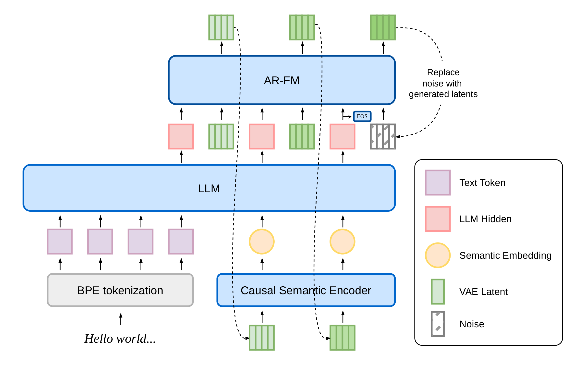
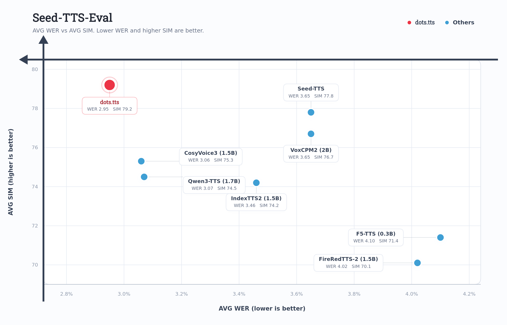
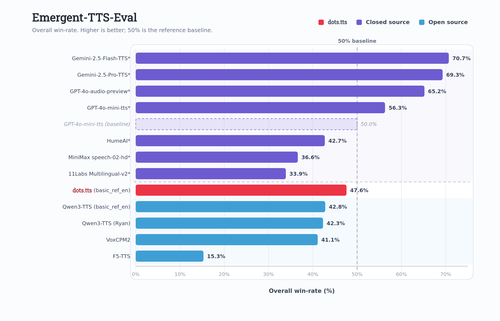
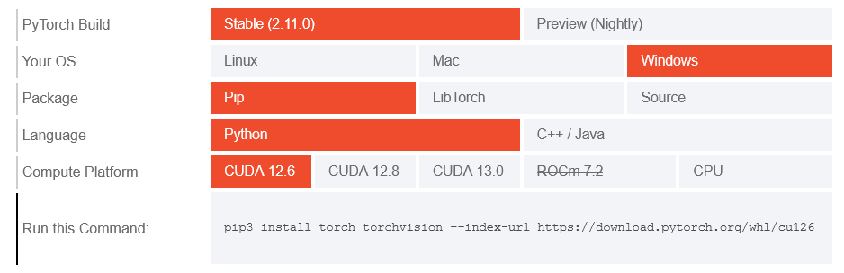
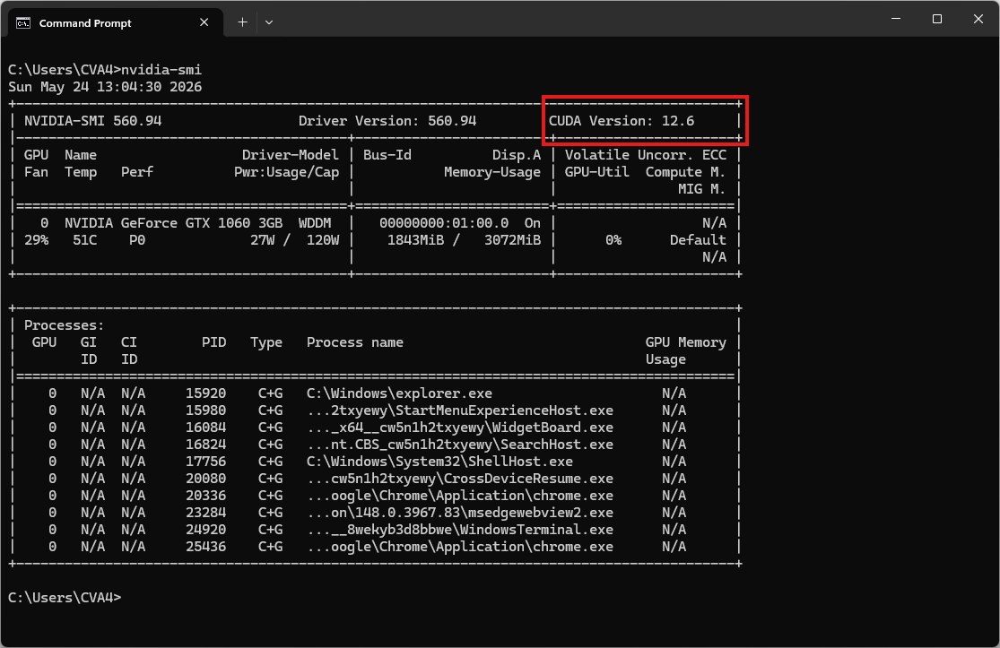
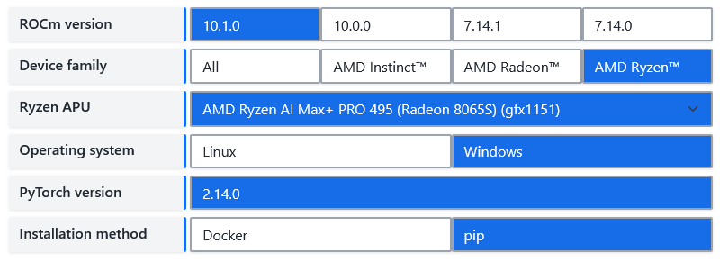

## Introduction

**dots.tts** is a **2B-parameter fully continuous, end-to-end autoregressive (AR) text-to-speech system**. The backbone pairs a semantic encoder, an LLM, and an autoregressive flow-matching acoustic head over a **48 kHz** AudioVAE, with no discrete tokens anywhere in the pipeline.

GitHub: https://github.com/studio-dots-ai/dots.tts  
Hugging Face: https://github.com/collections/dots-studio/dotstts  
Playground: https://hf.co/spaces/dots-studio/dots.tts  
Demo Page: https://studio-dots-ai.github.io/dots.tts-demo/  
Report: https://arxiv.org/abs/2606.07080  



dots.tts achieves the best average performance on **Seed-TTS-Eval**, with WERs of **0.94% / 1.30% / 6.60%** and SIM scores of **81.0 / 77.1 / 79.5** on the zh / en / zh-hard test sets, respectively. It further attains the **highest average speaker similarity (83.9)** on the 24-language **MiniMax multilingual** benchmark. Across other benchmarks, dots.tts also consistently demonstrates **open-source state-of-the-art performance**, exhibiting strong generation stability, voice cloning ability, and emotional expressiveness.





## Prerequisites

System requirements:
*   **Operating System:** Windows 10/11 (64-bit), macOS, or Linux (Debian/Ubuntu).
*   **Python:** version >= 3.10 required
*   **Disk Space:** 10GB+ recommended (for dependencies and model cache). At least 400 MB for Miniconda; 3 GB+ for full Anaconda.
*   **The GPU** is optional but HIGHLY Recommended for Performance.
*   **Internet:** For downloading dependencies and models from Hugging Face Hub.



  
| Requirements | CPU | RAM |
| :--- | :--- | :--- |
| Minimum | Intel Core i3 or AMD Ryzen 3 | 8 GB |
| Recommended | Intel Core i5 or AMD Ryzen 5 | 16 GB |
| High-performance | Intel Core i7/i9 or AMD Ryzen 7/9 | 32 GB |
  

  
[Install PyTorch for NVIDIA](https://pytorch.org/get-started/locally/)


Note: CUDA version check by command

```bash
nvidia-smi
```


  

  
[Install PyTorch for ROCm](https://rocm.docs.amd.com/projects/ai-ecosystem/en/latest/frameworks/pytorch/install.html)

  

  
PyTorch can be installed and used on macOS. Depending on your system and GPU capabilities, your experience with PyTorch on macOS may vary in terms of processing time.
  



| Environment | Run this Command |
| :-- | :-- |
| CPU only  | `pip3 install torch torchvision` |
| Apple Silicon | `pip3 install torch torchvision` |
| AMD ROCm | [Install PyTorch for ROCm](https://rocm.docs.amd.com/projects/ai-ecosystem/en/latest/frameworks/pytorch/install.html) |
| CUDA 11.8 | `pip3 install torch torchvision torchaudio --index-url https://download.pytorch.org/whl/cu118` |
| CUDA 12.1 | `pip3 install torch torchvision torchaudio --index-url https://download.pytorch.org/whl/cu121` |
| CUDA 12.6 | `pip3 install torch torchvision torchaudio --index-url https://download.pytorch.org/whl/cu126` |
| CUDA 12.8 | `pip3 install torch torchvision torchaudio --index-url https://download.pytorch.org/whl/cu128` |
| CUDA 13.0 | `pip3 install torch torchvision torchaudio --index-url https://download.pytorch.org/whl/cu130` |


## Video tutorial

Coming soon!
<!--  -->


## Step 1. Install Miniconda Package



  
Download Miniconda: https://www.anaconda.com/download/success?reg=skipped

Direct link: https://anaconda.com/api/installers/Miniconda3-latest-Windows-x86_64.exe  
Direct link: https://repo.anaconda.com/miniconda/Miniconda3-latest-Windows-arm64.exe

> How to [Install Miniconda on Windows](https://cva4.com/tuts/tts/miniconda/)
  

  
Download Miniconda: https://www.anaconda.com/download/success?reg=skipped

Direct link: https://anaconda.com/api/installers/Miniconda3-latest-MacOSX-arm64.pkg

> How to [Install Miniconda on MacOS](https://cva4.com/tuts/tts/miniconda/#install-miniconda-on-macos)
  

  
Download Miniconda: https://www.anaconda.com/download/success?reg=skipped

Direct link: https://repo.anaconda.com/miniconda/Miniconda3-latest-Linux-x86_64.sh  
Direct link: https://repo.anaconda.com/miniconda/Miniconda3-latest-Linux-aarch64.sh

> How to [Install Miniconda on Linux](https://cva4.com/tuts/tts/miniconda/#install-miniconda-on-linux)
  




## Step 2. Create Conda Environment

Create an environment.yml file



  
```yml
name: dots_tts
channels:
  - conda-forge
  - defaults

dependencies:
  # Python version (requires >=3.10,<3.13)
  - python=3.10
  - pip

  # Handled via Conda to guarantee OpenFST binary mapping
  - pynini

  - pip:
      # PyTorch CPU only
      - torch==2.8.0
      - torchaudio==2.8.0

      # Install dots.tts directly from PyPI
      - dots.tts
```
  

  
```yml
name: dots_tts
channels:
  - conda-forge
  - defaults

dependencies:
  # Python version (requires >=3.10,<3.13)
  - python=3.10
  - pip

  # Handled via Conda to guarantee OpenFST binary mapping
  - pynini

  - pip:
      # PyTorch CUDA wheels. Replace cu126 with your CUDA version if needed
      - --index-url https://download.pytorch.org/whl/cu126
      # Required so the non-PyTorch packages below still resolve from PyPI.
      - --extra-index-url https://pypi.org/simple
      # Pinned in lockstep with pyproject.toml / requirements.txt.
      - torch==2.8.0+cu126
      - torchaudio==2.8.0+cu126

      # Install dots.tts directly from PyPI
      - dots.tts
```
  

  
> Coming soon!
  

  
```yml
name: dots_tts
channels:
  - conda-forge
  - defaults

dependencies:
  # Python version (requires >=3.10,<3.13)
  - python=3.10
  - pip

  # Handled via Conda to guarantee OpenFST binary mapping
  - pynini

  - pip:
      # PyTorch MPS (Metal Performance Shaders)
      - torch==2.8.0
      - torchaudio==2.8.0

      # Install dots.tts directly from PyPI
      - dots.tts
```
  




Activate conda environment:

```bash
conda env create -f environment.yml
conda activate dots_tts
```

<!-- ### Download weights -->

<!-- ### Directory structure -->


## Step 3. Run the Inference

### Command Line Interface

```bash
# sanity check
dots.tts --help
```

```bash
usage: dots.tts [-h] --model-name-or-path MODEL_NAME_OR_PATH [--revision REVISION] [--cache-dir CACHE_DIR] --text TEXT [--output OUTPUT] [--precision PRECISION] [--seed SEED] [--prompt-audio PROMPT_AUDIO]
                [--prompt-text PROMPT_TEXT] [--language LANGUAGE] [--template-name {tts,instruction_tts,text_to_audio,tts_interleave}] [--ode-method ODE_METHOD] [--num-steps NUM_STEPS]
                [--guidance-scale GUIDANCE_SCALE] [--speaker-scale SPEAKER_SCALE] [--max-generate-length MAX_GENERATE_LENGTH] [--max-sequence-length MAX_SEQUENCE_LENGTH] [--normalize-text]
                [--profile-inference] [--profile-inference-calls]

dots.tts inference CLI.

options:
  -h, --help            show this help message and exit
  --model-name-or-path MODEL_NAME_OR_PATH
                        Local pretrained directory or Hugging Face repo id
  --revision REVISION   Optional Hugging Face revision
  --cache-dir CACHE_DIR
                        Optional Hugging Face cache dir
  --text TEXT           Input text
  --output OUTPUT       Output wav file path
  --precision PRECISION
                        Inference precision
  --seed SEED           Random seed for inference.
  --prompt-audio PROMPT_AUDIO
                        Path to prompt audio
  --prompt-text PROMPT_TEXT
                        Transcript of prompt audio
  --language LANGUAGE   Language tag mode. Default: none. Supported values: none, auto_detect, or a language code/name such as EN/en/english/chinese.
  --template-name {tts,instruction_tts,text_to_audio,tts_interleave}
                        Named template preset for generation.
  --ode-method ODE_METHOD
                        ODE solver method (default: artifact setting, otherwise euler)
  --num-steps NUM_STEPS
                        Sampling steps (default: artifact setting, otherwise 10)
  --guidance-scale GUIDANCE_SCALE
                        Classifier-free guidance scale (default: artifact setting, otherwise 1.2)
  --speaker-scale SPEAKER_SCALE
                        Scale applied to the reference speaker embedding
  --max-generate-length MAX_GENERATE_LENGTH
                        Maximum total audio patch count (prompt + generated)
  --max-sequence-length MAX_SEQUENCE_LENGTH
                        Maximum LLM sequence length used for schedule validation and optimized StaticCache
  --normalize-text      Whether to normalize text before inference
  --profile-inference   Collect per-module inference timing statistics
  --profile-inference-calls
                        Log each profiled inference call timing
```

**Checkpoints**

Seven pretrained checkpoints are released on Hugging Face. They share the same backbone; choose by task and runtime entry point.

- [`dots.tts-base`](https://huggingface.co/dots-studio/dots.tts-base): Pretraining baseline; fine-tuning base.
- [`dots.tts-soar`](https://huggingface.co/dots-studio/dots.tts-soar): Highest speaker similarity; high-quality voice cloning; fine-tuning.
- [`dots.tts-mf`](https://huggingface.co/dots-studio/dots.tts-mf): Latency- or concurrency-sensitive TTS.
- [`dots.tts-mf-2steps`](https://huggingface.co/dots-studio/dots.tts-mf-2steps): Latency- or concurrency-sensitive TTS.
- [`dots.tts-mf-1step`](https://huggingface.co/dots-studio/dots.tts-mf-1step): Latency- or concurrency-sensitive TTS.
- [`dots.tts-mf-2steps-stts`](https://huggingface.co/dots-studio/dots.tts-mf-2steps-stts): LLM interaction and duplex dialogue.
- [`dots.tts.edit`](https://huggingface.co/dots-studio/dots.tts.edit): Speech editing.

Pass the repo id directly to the entry point shown above; the snapshot is fetched on first use and cached locally. Fixed-step artifacts reject incompatible sampling overrides.


Now, run the basic example script to synthesize speech:

```bash
# Random-voice sampling (no reference) — only meaningful with a fine-tuned
# single-speaker checkpoint
dots.tts --model-name-or-path dots-studio/dots.tts-soar --precision float32 --text "Hello, this is a quick speech synthesis test." --output output.wav
```

The result will be the audio file `output.wav`

**Test Voice Cloning**

Download the reference audio

```bash
curl -L -O "http://cva4.com/audio/prompt_english_female1.wav"
```

Reference audio sample voice: `prompt_english_female1.wav`

<audio controls>
  <source src="/audio/prompt_english_female1.wav" type="audio/mpeg">
  Your browser does not support the audio element.
</audio>


Now, run the script to clone reference audio:

```bash
# X-vector-only voice cloning (reference audio only — timbre from speaker x-vector)
dots.tts --model-name-or-path dots-studio/dots.tts-soar --precision float32 --text "Hello, this is a zero-shot voice cloning demonstration." --prompt-audio prompt_english_female1.wav --output clone.wav

# Continuation voice cloning (reference audio + transcript) — recommended, best SIM
dots.tts --model-name-or-path dots-studio/dots.tts-soar --precision float32 --text "Hello, this is a zero-shot voice cloning demonstration." --prompt-audio prompt_english_female1.wav --prompt-text "In order to win, you must expect to win." --output clone.wav
```

The output will be an audio file named `clone.wav`


### Python Script

Create a file named `dots_test.py`:

```python
from dots_tts.runtime import DotsTtsRuntime
import soundfile as sf

runtime = DotsTtsRuntime.from_pretrained(
    "dots-studio/dots.tts-soar",
    precision="float32",
    optimize=False,  # torch.compile acceleration (warmup at load, faster steady-state)
)

result = runtime.generate(
    text="Hello, this is a quick speech synthesis test.",
    prompt_audio_path="prompt_english_female1.wav",
    prompt_text="In order to win, you must expect to win.",
    num_steps=10,
    guidance_scale=1.2,
)

sf.write("output.wav", result["audio"].float().cpu().squeeze().numpy(), result["sample_rate"])
```

Run the script to clone voice:

```bash
python dots_test.py
```

The result will be the audio file `clone.wav`

<!-- **Streaming Python API** -->

<!-- Speech Editing -->


### Web Demo (Gradio)

Clone dots.tts from GitHub (run after activating the environment)

```bash
git clone https://github.com/studio-dots-ai/dots.tts.git
cd dots.tts
```

Try dots.tts without coding:

```bash
python apps/gradio/app.py --model-name-or-path dots-studio/dots.tts-soar --precision float32
```

Open your browser and navigate to [http://127.0.0.1:7860](http://127.0.0.1:7860). The system will automatically load the model weights during this first run. Please wait for the model to be ready!
