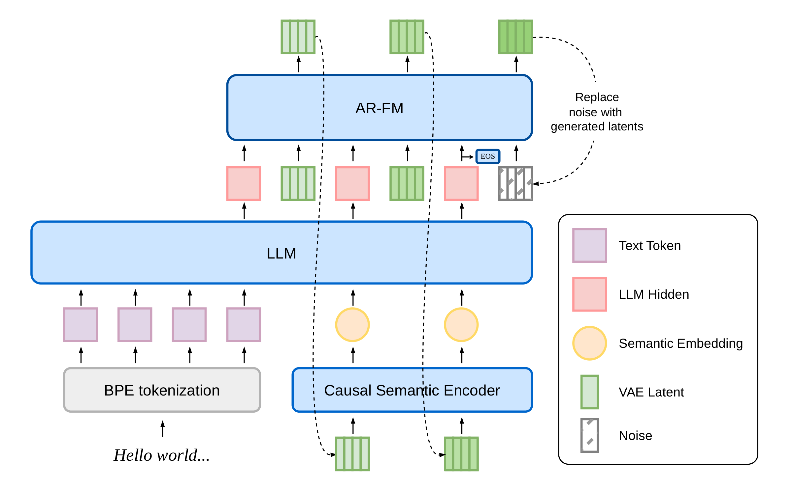
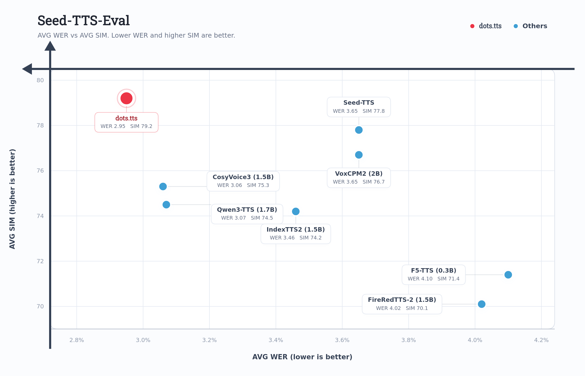
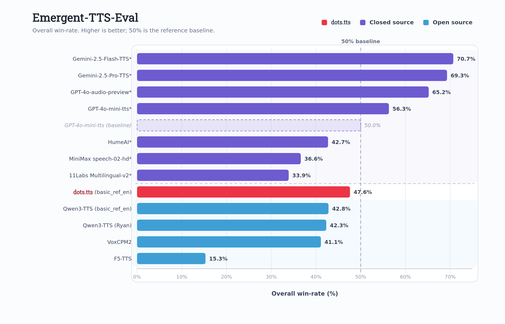
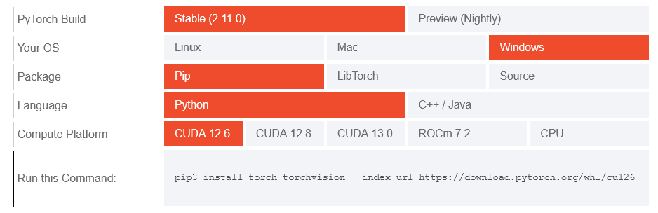
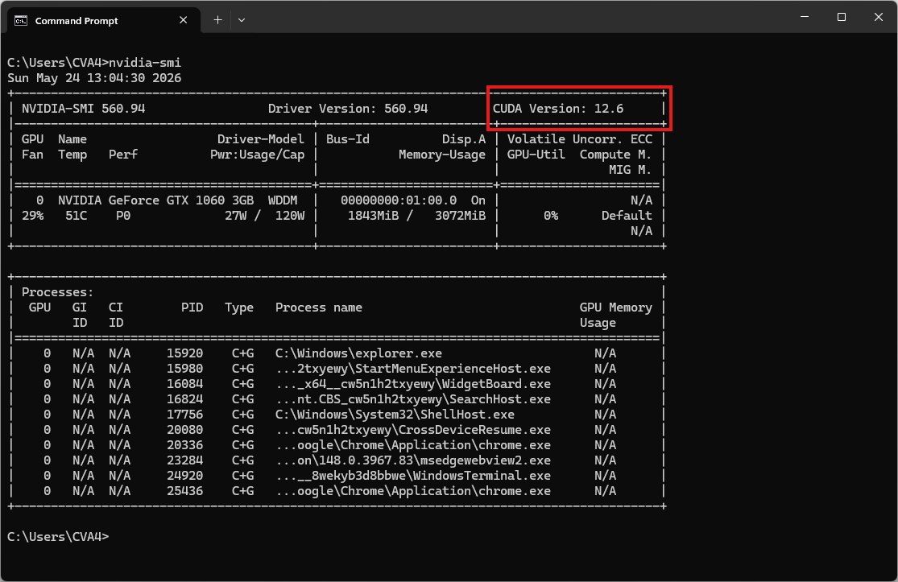
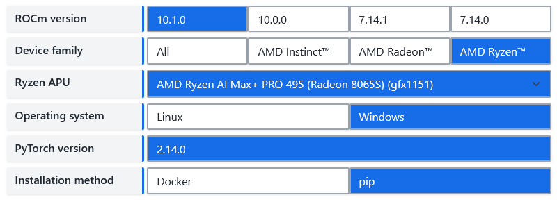

## Giới thiệu

**dots.tts** là một hệ thống chuyển văn bản thành giọng nói (TTS) dựa trên mô hình tự hồi quy (autoregressive - AR) từ đầu đến cuối (end-to-end), với cấu trúc hoàn toàn liên tục và quy mô **2 tỷ tham số**. Hệ thống này kết hợp một bộ mã hóa ngữ nghĩa, một mô hình ngôn ngữ lớn (LLM) và một thành phần tạo âm thanh (acoustic head) dựa trên cơ chế "flow-matching" tự hồi quy, vận hành trên nền tảng AudioVAE với tần số lấy mẫu **48 kHz**; toàn bộ quy trình xử lý hoàn toàn không sử dụng các token rời rạc (discrete tokens).

GitHub: https://github.com/studio-dots-ai/dots.tts  
Hugging Face: https://hf.co/collections/dots-studio/dotstts  
Playground: https://hf.co/spaces/dots-studio/dots.tts  
Demo Page: https://studio-dots-ai.github.io/dots.tts-demo/  
Report: https://arxiv.org/abs/2606.07080  



dots.tts đạt hiệu suất trung bình tốt nhất trên bộ dữ liệu đánh giá **Seed-TTS-Eval**, với các chỉ số WER lần lượt là **0,94% / 1,30% / 6,60%** và điểm SIM tương ứng là **81,0 / 77,1 / 79,5** trên các tập kiểm thử tiếng Trung (zh), tiếng Anh (en) và tiếng Trung khó (zh-hard). Hệ thống này cũng đạt **điểm tương đồng giọng nói trung bình cao nhất (83,9)** trên bộ tiêu chuẩn đánh giá đa ngôn ngữ **MiniMax** (bao gồm 24 ngôn ngữ). Trên các bộ tiêu chuẩn đánh giá khác, dots.tts liên tục khẳng định vị thế là mô hình mã nguồn mở có hiệu suất tiên tiến nhất, thể hiện sự ổn định vượt trội trong quá trình tạo giọng nói, khả năng sao chép giọng nói (voice cloning) và khả năng truyền tải cảm xúc.





## Yêu cầu hệ thống

* **Hệ điều hành:** Windows 10/11 (64-bit), macOS hoặc Linux (Debian/Ubuntu).
* **Python:** Yêu cầu phiên bản >= 3.10
* **Dung lượng ổ cứng:** Khuyến nghị 10GB trở lên (cho các thư viện phụ thuộc và bộ nhớ cache mô hình). Ít nhất 400 MB cho Miniconda; 3 GB trở lên cho Anaconda đầy đủ.
* **GPU:** là tùy chọn nhưng RẤT KHUYÊN DÙNG để tăng hiệu suất.
* **Internet:** Để tải xuống các thư viện phụ thuộc và mô hình từ Hugging Face Hub.



  
| Mức yêu cầu | CPU | RAM |
| :--- | :--- | :--- |
| Tối thiểu | Intel Core i3 hoặc AMD Ryzen 3 | 8 GB |
| Khuyến nghị | Intel Core i5 hoặc AMD Ryzen 5 | 16 GB |
| Hiệu năng cao | Intel Core i7/i9 hoặc AMD Ryzen 7/9 | 32 GB |
  

  
[Install PyTorch for NVIDIA](https://pytorch.org/get-started/locally/)


Lưu ý: Kiểm tra phiên bản CUDA bằng lệnh

```bash
nvidia-smi
```


  

  
[Install PyTorch for ROCm](https://rocm.docs.amd.com/projects/ai-ecosystem/en/latest/frameworks/pytorch/install.html)

  

  
PyTorch có thể được cài đặt và sử dụng trên macOS. Tùy thuộc vào hệ thống và khả năng của GPU, trải nghiệm của bạn khi sử dụng PyTorch trên macOS có thể khác biệt về thời gian xử lý.
  



| Môi trường | Chạy lệnh để cài đặt  | Kiến trúc |
| :-- | :-- | :-- |
| CPU only  | `pip3 install torch torchvision` | IA-32 and Intel 64 |
| Apple Silicon | `pip3 install torch torchvision` | |
| AMD ROCm | [Install PyTorch for ROCm](https://rocm.docs.amd.com/projects/ai-ecosystem/en/latest/frameworks/pytorch/install.html) | |
| CUDA 11.8 | `pip3 install torch torchvision torchaudio --index-url https://download.pytorch.org/whl/cu118` | Kepler/Maxwell → Ada Lovelace, Hopper |
| CUDA 12.1 | `pip3 install torch torchvision torchaudio --index-url https://download.pytorch.org/whl/cu121` | Kepler/Maxwell → Ada Lovelace, Hopper |
| CUDA 12.4 | `pip3 install torch torchvision torchaudio --index-url https://download.pytorch.org/whl/cu124` | Kepler/Maxwell → Ada Lovelace, Hopper |
| CUDA 12.6 | `pip3 install torch torchvision torchaudio --index-url https://download.pytorch.org/whl/cu126` | Maxwell → Hopper |
| CUDA 12.8 | `pip3 install torch torchvision torchaudio --index-url https://download.pytorch.org/whl/cu128` | Volta → Blackwell |
| CUDA 12.9 | `pip3 install torch torchvision torchaudio --index-url https://download.pytorch.org/whl/cu129` | Volta → Blackwell |
| CUDA 13.0 | `pip3 install torch torchvision torchaudio --index-url https://download.pytorch.org/whl/cu130` | Turing → Blackwell |
| CUDA 13.2 | `pip3 install torch torchvision torchaudio --index-url https://download.pytorch.org/whl/cu132` | Turing → Blackwell |
| CUDA 13.4 | `pip3 install torch torchvision torchaudio --index-url https://download.pytorch.org/whl/cu134` | Turing → Blackwell |

Các phiên bản PyTorch khả dụng:

```
pip index versions torch
pip index versions torchaudio
pip index versions torchvision
pip index versions torch --index-url https://download.pytorch.org/whl/cu118
pip index versions torchaudio --index-url https://download.pytorch.org/whl/cu118
pip index versions torchvision --index-url https://download.pytorch.org/whl/cu118
```

| Môi trường | 2.15.0 | 2.14.1 | 2.14.0 | 2.13.0 | 2.12.1 | 2.12.0 | 2.11.0 | 2.10.0 | 2.9.1 | 2.9.0 | 2.8.0 | 2.7.1 | 2.7.0 | 2.6.0 | 2.5.1 | 2.5.0 | 2.4.1 | 2.4.0 | 2.3.1 | 2.3.0 | 2.2.2 | 2.2.1 | 2.2.0 | 2.1.2 | 2.1.1 | 2.1.0 | 2.0.1 | 2.0.0 | 1.13.1 | 1.13.0 | 1.12.1 | 1.12.0 | 1.11.0 |
| --- | --- | --- | --- | --- | --- | --- | --- | --- | --- | --- | --- | --- | --- | --- | --- | --- | --- | --- | --- | --- | --- | --- | --- | --- | --- | --- | --- | --- | --- | --- | --- | --- | --- |
| cpu | ✅ | ✅ | ✅ | ✅ | ✅ | ✅ | ✅ | ✅ | ✅ | ✅ | ✅ | ✅ | ✅ | ✅ | ✅ | ✅ | ✅ | ✅ | ✅ | ✅ | ✅ | ✅ | ✅ | ✅ | ✅ | ✅ | ✅ | ✅ | ✅ | ✅ | ✅ | ✅ | ✅ |
| cu118 |  |  |  |  |  |  |  |  |  |  |  | ✅ | ✅ | ✅ | ✅ | ✅ | ✅ | ✅ | ✅ | ✅ | ✅ | ✅ | ✅ | ✅ | ✅ | ✅ | ✅ | ✅ |  |  |  |  |  |
| cu121 |  |  |  |  |  |  |  |  |  |  |  |  |  |  | ✅ | ✅ | ✅ | ✅ | ✅ | ✅ | ✅ | ✅ | ✅ | ✅ | ✅ | ✅ |  |  |  |  |  |  |  |
| cu124 |  |  |  |  |  |  |  |  |  |  |  |  |  | ✅ | ✅ | ✅ | ✅ | ✅ |  |  |  |  |  |  |  |  |  |  |  |  |  |  |  |
| cu126 |  | ✅ | ✅ | ✅ | ✅ | ✅ | ✅ | ✅ | ✅ | ✅ | ✅ | ✅ | ✅ | ✅ |  |  |  |  |  |  |  |  |  |  |  |  |  |  |  |  |  |  |  |
| cu128 |  |  |  |  |  |  | ✅ | ✅ | ✅ | ✅ | ✅ | ✅ | ✅ |  |  |  |  |  |  |  |  |  |  |  |  |  |  |  |  |  |  |  |  |
| cu129 |  |  |  |  |  |  |  |  |  | ✅ | ✅ |  |  |  |  |  |  |  |  |  |  |  |  |  |  |  |  |  |  |  |  |  |  |
| cu130 |  | ✅ | ✅ | ✅ | ✅ | ✅ | ✅ | ✅ | ✅ | ✅ |  |  |  |  |  |  |  |  |  |  |  |  |  |  |  |  |  |  |  |  |  |  |  |
| cu132 | ✅ | ✅ | ✅ | ✅ | ✅ | ✅ |  |  |  |  |  |  |  |  |  |  |  |  |  |  |  |  |  |  |  |  |  |  |  |  |  |  |  |
| cu134 | ✅ |  |  |  |  |  |  |  |  |  |  |  |  |  |  |  |  |  |  |  |  |  |  |  |  |  |  |  |  |  |  |  |  |


## Video hướng dẫn

<!-- Sắp ra mắt! -->



## Bước 1. Cài đặt Miniconda



  
Tải xuống Miniconda: https://www.anaconda.com/download/success?reg=skipped

Liên kết trực tiếp: https://anaconda.com/api/installers/Miniconda3-latest-Windows-x86_64.exe  
Liên kết trực tiếp: https://repo.anaconda.com/miniconda/Miniconda3-latest-Windows-arm64.exe

> Cài đặt [Miniconda trên Windows](https://cva4.com/vi/tuts/tts/miniconda/)
  

  
Tải xuống Miniconda: https://www.anaconda.com/download/success?reg=skipped

Liên kết trực tiếp: https://anaconda.com/api/installers/Miniconda3-latest-MacOSX-arm64.pkg

> Cài đặt [Miniconda trên MacOS](https://cva4.com/vi/tuts/tts/miniconda/#c%c3%a0i-%c4%91%e1%ba%b7t-tr%c3%aan-macoslinux)
  

  
Tải xuống Miniconda: https://www.anaconda.com/download/success?reg=skipped

Liên kết trực tiếp: https://repo.anaconda.com/miniconda/Miniconda3-latest-Linux-x86_64.sh  
Liên kết trực tiếp: https://repo.anaconda.com/miniconda/Miniconda3-latest-Linux-aarch64.sh

> Cài đặt [Miniconda trên Linux](https://cva4.com/vi/tuts/tts/miniconda/#c%c3%a0i-%c4%91%e1%ba%b7t-tr%c3%aan-macoslinux)
  




## Bước 2. Tạo môi trường Conda

Tạo tệp environment.yml:



  
```yml
name: dots_tts
channels:
  - conda-forge
  - defaults

dependencies:
  # Python version (requires >=3.10,<3.13)
  - python=3.10
  - pip

  # Handled via Conda to guarantee OpenFST binary mapping
  - pynini

  - pip:
      # PyTorch CPU only
      - torch==2.8.0
      - torchaudio==2.8.0

      # Install dots.tts directly from PyPI
      - dots.tts
```
  

  
```yml
name: dots_tts
channels:
  - conda-forge
  - defaults

dependencies:
  # Python version (requires >=3.10,<3.13)
  - python=3.10
  - pip

  # Handled via Conda to guarantee OpenFST binary mapping
  - pynini

  - pip:
      # PyTorch CUDA wheels. Replace cu126 with your CUDA version if needed
      - --index-url https://download.pytorch.org/whl/cu126
      # Required so the non-PyTorch packages below still resolve from PyPI.
      - --extra-index-url https://pypi.org/simple
      # Pinned in lockstep with pyproject.toml / requirements.txt.
      - torch==2.8.0+cu126
      - torchaudio==2.8.0+cu126

      # Install dots.tts directly from PyPI
      - dots.tts
```
  

  
> Sắp ra mắt!
  

  
```yml
name: dots_tts
channels:
  - conda-forge
  - defaults

dependencies:
  # Python version (requires >=3.10,<3.13)
  - python=3.10
  - pip

  # Handled via Conda to guarantee OpenFST binary mapping
  - pynini

  - pip:
      # PyTorch MPS (Metal Performance Shaders)
      - torch==2.8.0
      - torchaudio==2.8.0

      # Install dots.tts directly from PyPI
      - dots.tts
```
  




Kích hoạt môi trường conda:

```bash
conda env create -f environment.yml
conda activate dots_tts
```


## Bước 3. Chạy suy luận

### Command Line Interface

```bash
# sanity check
dots.tts --help
```

```bash
usage: dots.tts [-h] --model-name-or-path MODEL_NAME_OR_PATH [--revision REVISION] [--cache-dir CACHE_DIR] --text TEXT [--output OUTPUT] [--precision PRECISION] [--seed SEED] [--prompt-audio PROMPT_AUDIO]
                [--prompt-text PROMPT_TEXT] [--language LANGUAGE] [--template-name {tts,instruction_tts,text_to_audio,tts_interleave}] [--ode-method ODE_METHOD] [--num-steps NUM_STEPS]
                [--guidance-scale GUIDANCE_SCALE] [--speaker-scale SPEAKER_SCALE] [--max-generate-length MAX_GENERATE_LENGTH] [--max-sequence-length MAX_SEQUENCE_LENGTH] [--normalize-text]
                [--profile-inference] [--profile-inference-calls]

dots.tts inference CLI.

options:
  -h, --help            show this help message and exit
  --model-name-or-path MODEL_NAME_OR_PATH
                        Local pretrained directory or Hugging Face repo id
  --revision REVISION   Optional Hugging Face revision
  --cache-dir CACHE_DIR
                        Optional Hugging Face cache dir
  --text TEXT           Input text
  --output OUTPUT       Output wav file path
  --precision PRECISION
                        Inference precision
  --seed SEED           Random seed for inference.
  --prompt-audio PROMPT_AUDIO
                        Path to prompt audio
  --prompt-text PROMPT_TEXT
                        Transcript of prompt audio
  --language LANGUAGE   Language tag mode. Default: none. Supported values: none, auto_detect, or a language code/name such as EN/en/english/chinese.
  --template-name {tts,instruction_tts,text_to_audio,tts_interleave}
                        Named template preset for generation.
  --ode-method ODE_METHOD
                        ODE solver method (default: artifact setting, otherwise euler)
  --num-steps NUM_STEPS
                        Sampling steps (default: artifact setting, otherwise 10)
  --guidance-scale GUIDANCE_SCALE
                        Classifier-free guidance scale (default: artifact setting, otherwise 1.2)
  --speaker-scale SPEAKER_SCALE
                        Scale applied to the reference speaker embedding
  --max-generate-length MAX_GENERATE_LENGTH
                        Maximum total audio patch count (prompt + generated)
  --max-sequence-length MAX_SEQUENCE_LENGTH
                        Maximum LLM sequence length used for schedule validation and optimized StaticCache
  --normalize-text      Whether to normalize text before inference
  --profile-inference   Collect per-module inference timing statistics
  --profile-inference-calls
                        Log each profiled inference call timing
```

**Các điểm kiểm tra (Checkpoints)**

Bảy điểm kiểm tra (checkpoint) đã được huấn luyện trước hiện đã có trên Hugging Face. Tất cả đều sử dụng cùng một cấu trúc nền tảng (backbone); bạn có thể lựa chọn tùy theo tác vụ và yêu cầu vận hành cụ thể:

- [`dots.tts-base`](https://huggingface.co/dots-studio/dots.tts-base): Mô hình cơ sở (baseline) đã qua huấn luyện trước; dùng để tinh chỉnh (fine-tuning).
- [`dots.tts-soar`](https://huggingface.co/dots-studio/dots.tts-soar): Tối ưu hóa độ tương đồng với giọng nói gốc; hỗ trợ sao chép giọng nói (voice cloning) chất lượng cao; phù hợp để tinh chỉnh.
- [`dots.tts-mf`](https://huggingface.co/dots-studio/dots.tts-mf): Dành cho các tác vụ TTS yêu cầu độ trễ thấp hoặc khả năng xử lý đồng thời cao.
- [`dots.tts-mf-2steps`](https://huggingface.co/dots-studio/dots.tts-mf-2steps): Dành cho các tác vụ TTS yêu cầu độ trễ thấp hoặc khả năng xử lý đồng thời cao.
- [`dots.tts-mf-1step`](https://huggingface.co/dots-studio/dots.tts-mf-1step): Dành cho các tác vụ TTS yêu cầu độ trễ thấp hoặc khả năng xử lý đồng thời cao.
- [`dots.tts-mf-2steps-stts`](https://huggingface.co/dots-studio/dots.tts-mf-2steps-stts): Dành cho tương tác với mô hình ngôn ngữ lớn (LLM) và đối thoại hai chiều (duplex dialogue).
- [`dots.tts.edit`](https://huggingface.co/dots-studio/dots.tts.edit): Dành cho tác vụ chỉnh sửa giọng nói (speech editing).

Hãy truyền trực tiếp ID kho lưu trữ (repo id) đến điểm truy cập (entry point) được hiển thị ở trên; ảnh chụp nhanh (snapshot) sẽ được tải về khi sử dụng lần đầu và được lưu vào bộ nhớ đệm cục bộ. Các tạo phẩm có bước cố định sẽ từ chối các ghi đè lấy mẫu không tương thích.


Bây giờ, hãy chạy tập lệnh ví dụ cơ bản để tổng hợp giọng nói:

```bash
# Random-voice sampling (no reference) — only meaningful with a fine-tuned
# single-speaker checkpoint
dots.tts --model-name-or-path dots-studio/dots.tts-soar --precision float32 --text "Hello, this is a quick speech synthesis test." --output output.wav
```

Kết quả sẽ là tệp âm thanh `output.wav`


**Chạy thử sao chép giọng nói**

Tải xuống bản ghi âm tham khảo

```bash
curl -L -O "http://cva4.com/audio/prompt_english_female1.wav"
```

Mẫu âm thanh tham khảo: `prompt_english_female1.wav`

<audio controls>
  <source src="/audio/prompt_english_female1.wav" type="audio/mpeg">
  Your browser does not support the audio element.
</audio>


Bây giờ, hãy chạy tập lệnh để tạo bản sao âm thanh dựa trên tệp âm thanh tham chiếu:

```bash
# X-vector-only voice cloning (reference audio only — timbre from speaker x-vector)
dots.tts --model-name-or-path dots-studio/dots.tts-soar --precision float32 --text "Hello, this is a zero-shot voice cloning demonstration." --prompt-audio prompt_english_female1.wav --output clone.wav

# Continuation voice cloning (reference audio + transcript) — recommended, best SIM
dots.tts --model-name-or-path dots-studio/dots.tts-soar --precision float32 --text "Hello, this is a zero-shot voice cloning demonstration." --prompt-audio prompt_english_female1.wav --prompt-text "In order to win, you must expect to win." --output clone.wav
```

Kết quả đầu ra sẽ là một tệp âm thanh có tên là `clone.wav`


### Chạy suy luận bằng tệp Python

Tạo một tệp có tên `dots_test.py`:

```python
from dots_tts.runtime import DotsTtsRuntime
import soundfile as sf

runtime = DotsTtsRuntime.from_pretrained(
    "dots-studio/dots.tts-soar",
    precision="float32",
    optimize=False,  # torch.compile acceleration (warmup at load, faster steady-state)
)

result = runtime.generate(
    text="Hello, this is a quick speech synthesis test.",
    prompt_audio_path="prompt_english_female1.wav",
    prompt_text="In order to win, you must expect to win.",
    num_steps=10,
    guidance_scale=1.2,
)

sf.write("clone.wav", result["audio"].float().cpu().squeeze().numpy(), result["sample_rate"])
```

Chạy tập lệnh để sao chép giọng nói:

```bash
python dots_test.py
```

Kết quả sẽ là tệp âm thanh `out.wav`

<!-- **Streaming Python API** -->


### Khởi chạy giao diện Web

Clone dots.tts từ GitHub (chạy sau khi kích hoạt môi trường)

```bash
git clone https://github.com/studio-dots-ai/dots.tts.git
cd dots.tts
```

Sau khi cài đặt xong, bạn không cần viết code mà có thể bật ngay một giao diện Web UI cục bộ bằng lệnh:

```bash
python apps/gradio/app.py --model-name-or-path dots-studio/dots.tts-soar --precision float32
```

Mở trình duyệt và truy cập vào địa chỉ [http://127.0.0.1:7860](http://127.0.0.1:7860) để bắt đầu sử dụng. Hệ thống sẽ tự động tải các tệp Model (Trọng số cấu hình mã nguồn) trong lần đầu chạy. Vui lòng đợi cho đến khi mô hình sẵn sàng!
