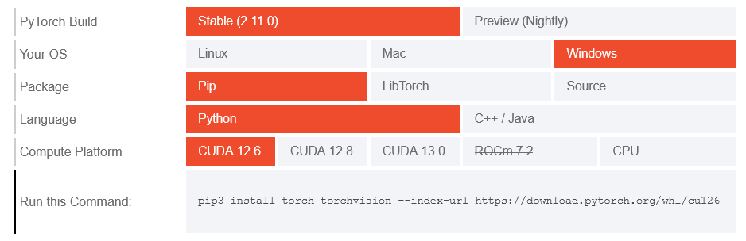
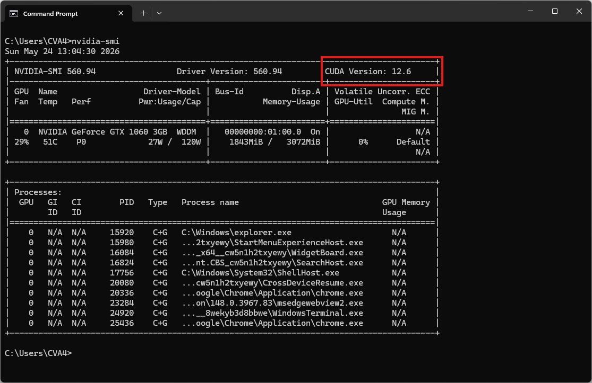
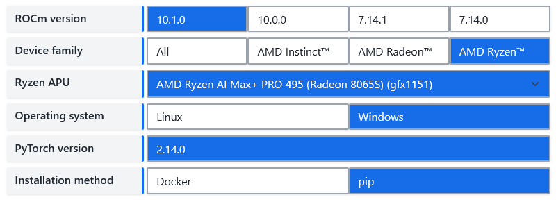

## Giới thiệu

Sopro (bắt nguồn từ từ "hơi thở/luồng hơi" trong tiếng Bồ Đào Nha) là một dòng mô hình chuyển đổi văn bản thành giọng nói (TTS) có khả năng sao chép giọng nói và sở hữu trọng lượng nhẹ. Kho lưu trữ này cung cấp **sopro-v2-turbo** – một mô hình mã nguồn mở với 120 triệu tham số, hỗ trợ xử lý luồng (streaming), vận hành mượt mà trên CPU máy tính xách tay hoặc ngay trong trình duyệt, đồng thời đạt chất lượng độ rõ nét ngang tầm các hệ thống lớn hơn nhiều (đạt chuẩn SOTA).

GitHub: https://github.com/samuel-vitorino/sopro  
Hugging Face: https://hf.co/samuel-vitorino/sopro-v2-turbo  
Demo: https://hf.co/spaces/samuel-vitorino/sopro-v2-turbo-tts  
Example: https://samuel-vitorino.github.io/sopro/  

Các tính năng chính:

- **120 triệu tham số**
- **Hỗ trợ tiếng Anh, tiếng Bồ Đào Nha (châu Âu), tiếng Pháp và tiếng Đức**
- **Phát trực tuyến (streaming)** với thời gian tạo đoạn âm thanh đầu tiên khoảng 300 ms trên CPU máy tính xách tay
- **Sao chép giọng nói "zero-shot"** (không cần huấn luyện thêm) từ 5-20 giây âm thanh tham chiếu
- **Tốc độ xử lý (RTF): 0,24 (ngoại tuyến) / 0,21 (trực tuyến)** trên CPU M3; **0,07** trên GPU H100
- **Chạy trực tiếp trên trình duyệt** thông qua môi trường thực thi ONNX (ONNX runtime)


## Yêu cầu hệ thống

* **Hệ điều hành:** Windows 10/11 (64-bit), macOS hoặc Linux (Debian/Ubuntu).
* **Python:** Yêu cầu phiên bản >= 3.10
* **Dung lượng ổ cứng:** Khuyến nghị 4GB trở lên (cho các thư viện phụ thuộc và bộ nhớ cache mô hình). Ít nhất 400 MB cho Miniconda; 3 GB trở lên cho Anaconda đầy đủ.
* **GPU:** là tùy chọn. Nó chạy mượt mà trên CPU của máy tính xách tay.
* **Internet:** Để tải xuống các thư viện phụ thuộc và mô hình từ Hugging Face Hub.



  
| Mức yêu cầu | CPU | RAM |
| :--- | :--- | :--- |
| Tối thiểu | Intel Core i3 hoặc AMD Ryzen 3 | 8 GB |
| Khuyến nghị | Intel Core i5 hoặc AMD Ryzen 5 | 16 GB |
| Hiệu năng cao | Intel Core i7/i9 hoặc AMD Ryzen 7/9 | 32 GB |
  

  
[Install PyTorch for NVIDIA](https://pytorch.org/get-started/locally/)


Lưu ý: Kiểm tra phiên bản CUDA bằng lệnh

```bash
nvidia-smi
```


  

  
[Install PyTorch for ROCm](https://rocm.docs.amd.com/projects/ai-ecosystem/en/latest/frameworks/pytorch/install.html)

  

  
PyTorch có thể được cài đặt và sử dụng trên macOS. Tùy thuộc vào hệ thống và khả năng của GPU, trải nghiệm của bạn khi sử dụng PyTorch trên macOS có thể khác biệt về thời gian xử lý.
  



| Môi trường | Chạy lệnh để cài đặt  | Kiến trúc |
| :-- | :-- | :-- |
| CPU only  | `pip3 install torch torchvision` | IA-32 and Intel 64 |
| Apple Silicon | `pip3 install torch torchvision` | |
| AMD ROCm | [Install PyTorch for ROCm](https://rocm.docs.amd.com/projects/ai-ecosystem/en/latest/frameworks/pytorch/install.html) | |
| CUDA 11.8 | `pip3 install torch torchvision torchaudio --index-url https://download.pytorch.org/whl/cu118` | Kepler/Maxwell → Ada Lovelace, Hopper |
| CUDA 12.1 | `pip3 install torch torchvision torchaudio --index-url https://download.pytorch.org/whl/cu121` | Kepler/Maxwell → Ada Lovelace, Hopper |
| CUDA 12.4 | `pip3 install torch torchvision torchaudio --index-url https://download.pytorch.org/whl/cu124` | Kepler/Maxwell → Ada Lovelace, Hopper |
| CUDA 12.6 | `pip3 install torch torchvision torchaudio --index-url https://download.pytorch.org/whl/cu126` | Maxwell → Hopper |
| CUDA 12.8 | `pip3 install torch torchvision torchaudio --index-url https://download.pytorch.org/whl/cu128` | Volta → Blackwell |
| CUDA 12.9 | `pip3 install torch torchvision torchaudio --index-url https://download.pytorch.org/whl/cu129` | Volta → Blackwell |
| CUDA 13.0 | `pip3 install torch torchvision torchaudio --index-url https://download.pytorch.org/whl/cu130` | Turing → Blackwell |
| CUDA 13.2 | `pip3 install torch torchvision torchaudio --index-url https://download.pytorch.org/whl/cu132` | Turing → Blackwell |
| CUDA 13.4 | `pip3 install torch torchvision torchaudio --index-url https://download.pytorch.org/whl/cu134` | Turing → Blackwell |

Các phiên bản PyTorch khả dụng:

```
pip index versions torch
pip index versions torchaudio
pip index versions torchvision
pip index versions torch --index-url https://download.pytorch.org/whl/cu118
pip index versions torchaudio --index-url https://download.pytorch.org/whl/cu118
pip index versions torchvision --index-url https://download.pytorch.org/whl/cu118
```

| Môi trường | 2.15.0 | 2.14.1 | 2.14.0 | 2.13.0 | 2.12.1 | 2.12.0 | 2.11.0 | 2.10.0 | 2.9.1 | 2.9.0 | 2.8.0 | 2.7.1 | 2.7.0 | 2.6.0 | 2.5.1 | 2.5.0 | 2.4.1 | 2.4.0 | 2.3.1 | 2.3.0 | 2.2.2 | 2.2.1 | 2.2.0 | 2.1.2 | 2.1.1 | 2.1.0 | 2.0.1 | 2.0.0 | 1.13.1 | 1.13.0 | 1.12.1 | 1.12.0 | 1.11.0 |
| --- | --- | --- | --- | --- | --- | --- | --- | --- | --- | --- | --- | --- | --- | --- | --- | --- | --- | --- | --- | --- | --- | --- | --- | --- | --- | --- | --- | --- | --- | --- | --- | --- | --- |
| cpu | ✅ | ✅ | ✅ | ✅ | ✅ | ✅ | ✅ | ✅ | ✅ | ✅ | ✅ | ✅ | ✅ | ✅ | ✅ | ✅ | ✅ | ✅ | ✅ | ✅ | ✅ | ✅ | ✅ | ✅ | ✅ | ✅ | ✅ | ✅ | ✅ | ✅ | ✅ | ✅ | ✅ |
| cu118 |  |  |  |  |  |  |  |  |  |  |  | ✅ | ✅ | ✅ | ✅ | ✅ | ✅ | ✅ | ✅ | ✅ | ✅ | ✅ | ✅ | ✅ | ✅ | ✅ | ✅ | ✅ |  |  |  |  |  |
| cu121 |  |  |  |  |  |  |  |  |  |  |  |  |  |  | ✅ | ✅ | ✅ | ✅ | ✅ | ✅ | ✅ | ✅ | ✅ | ✅ | ✅ | ✅ |  |  |  |  |  |  |  |
| cu124 |  |  |  |  |  |  |  |  |  |  |  |  |  | ✅ | ✅ | ✅ | ✅ | ✅ |  |  |  |  |  |  |  |  |  |  |  |  |  |  |  |
| cu126 |  | ✅ | ✅ | ✅ | ✅ | ✅ | ✅ | ✅ | ✅ | ✅ | ✅ | ✅ | ✅ | ✅ |  |  |  |  |  |  |  |  |  |  |  |  |  |  |  |  |  |  |  |
| cu128 |  |  |  |  |  |  | ✅ | ✅ | ✅ | ✅ | ✅ | ✅ | ✅ |  |  |  |  |  |  |  |  |  |  |  |  |  |  |  |  |  |  |  |  |
| cu129 |  |  |  |  |  |  |  |  |  | ✅ | ✅ |  |  |  |  |  |  |  |  |  |  |  |  |  |  |  |  |  |  |  |  |  |  |
| cu130 |  | ✅ | ✅ | ✅ | ✅ | ✅ | ✅ | ✅ | ✅ | ✅ |  |  |  |  |  |  |  |  |  |  |  |  |  |  |  |  |  |  |  |  |  |  |  |
| cu132 | ✅ | ✅ | ✅ | ✅ | ✅ | ✅ |  |  |  |  |  |  |  |  |  |  |  |  |  |  |  |  |  |  |  |  |  |  |  |  |  |  |  |
| cu134 | ✅ |  |  |  |  |  |  |  |  |  |  |  |  |  |  |  |  |  |  |  |  |  |  |  |  |  |  |  |  |  |  |  |  |


## Video hướng dẫn

<!-- Sắp ra mắt! -->



## Bước 1. Cài đặt Miniconda



  
Tải xuống Miniconda: https://www.anaconda.com/download/success?reg=skipped

Liên kết trực tiếp: https://anaconda.com/api/installers/Miniconda3-latest-Windows-x86_64.exe  
Liên kết trực tiếp: https://repo.anaconda.com/miniconda/Miniconda3-latest-Windows-arm64.exe

> Cài đặt [Miniconda trên Windows](https://cva4.com/vi/tuts/tts/miniconda/)
  

  
Tải xuống Miniconda: https://www.anaconda.com/download/success?reg=skipped

Liên kết trực tiếp: https://anaconda.com/api/installers/Miniconda3-latest-MacOSX-arm64.pkg

> Cài đặt [Miniconda trên MacOS](https://cva4.com/vi/tuts/tts/miniconda/#c%c3%a0i-%c4%91%e1%ba%b7t-tr%c3%aan-macoslinux)
  

  
Tải xuống Miniconda: https://www.anaconda.com/download/success?reg=skipped

Liên kết trực tiếp: https://repo.anaconda.com/miniconda/Miniconda3-latest-Linux-x86_64.sh  
Liên kết trực tiếp: https://repo.anaconda.com/miniconda/Miniconda3-latest-Linux-aarch64.sh

> Cài đặt [Miniconda trên Linux](https://cva4.com/vi/tuts/tts/miniconda/#c%c3%a0i-%c4%91%e1%ba%b7t-tr%c3%aan-macoslinux)
  




## Bước 2. Tạo môi trường Conda

Tạo tệp environment.yml:



  
```yml
name: soprotts
channels:
  - conda-forge
  - defaults
dependencies:
  # Python version (requires >= 3.10)
  - python=3.10

  - pip
  - pip:
      # PyTorch CPU only. It runs smoothly on a laptop CPU.
      - torch
      - torchaudio

      # Install SoproTTS directly from GitHub.
      - git+https://github.com/samuel-vitorino/sopro.git
```
  

  
```yml
name: soprotts
channels:
  - conda-forge
  - defaults
dependencies:
  # Python version (requires >= 3.10)
  - python=3.10

  - pip
  - pip:
      # PyTorch CUDA is optional. It runs smoothly on a laptop CPU.
      - --extra-index-url https://download.pytorch.org/whl/cu126
      - torch
      - torchaudio

      # Install SoproTTS directly from GitHub.
      - git+https://github.com/samuel-vitorino/sopro.git
```
  

  
> Coming soon!
  

  
```yml
name: soprotts
channels:
  - conda-forge
  - defaults
dependencies:
  # Python version (requires >= 3.10)
  - python=3.10

  - pip
  - pip:
      # PyTorch MPS (Metal Performance Shaders)
      - torch
      - torchaudio

      # Install SoproTTS directly from GitHub.
      - git+https://github.com/samuel-vitorino/sopro.git
```
  




Kích hoạt môi trường conda:

```bash
conda env create -f environment.yml
conda activate soprotts
```

Tải xuống bản ghi âm tham khảo

```bash
curl -L -O "http://cva4.com/audio/prompt_english_female1.wav"
```

Mẫu âm thanh tham khảo: `prompt_english_female1.wav`

<audio controls>
  <source src="/audio/prompt_english_female1.wav" type="audio/mpeg">
  Your browser does not support the audio element.
</audio>


## Bước 3. Chạy suy luận

Bây giờ, hãy chạy thử một vài ví dụ.

```bash
soprotts "Sopro is a lightweight 120 million parameter text-to-speech model that streams and runs on device." --ref prompt_english_female1.wav --out out.wav
```

Kết quả sẽ là tệp âm thanh `out.wav`


### Khởi chạy Giao diện Web (Gradio Web UI)

Sau khi cài đặt xong, bạn có thể chạy mô hình và mở bản demo bằng một lệnh duy nhất:

```bash
soprotts serve
```

Mở trình duyệt và truy cập vào địa chỉ [http://127.0.0.1:7860](http://127.0.0.1:7860) để bắt đầu sử dụng. Hệ thống sẽ tự động tải các file Model (Trọng số cấu hình mã nguồn) từ HuggingFace trong lần đầu chạy.